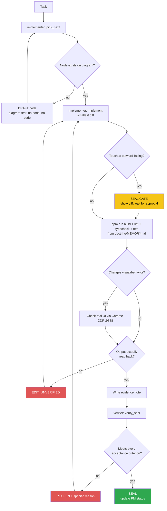

<!-- Diagram: dev-loop -->
<!-- Dev loop: plan - implement - verify - seal -->
DNA: 'smallest_diff / edit_x_read_back_proof_x_independent_verdict'
Auth: 65537 | Version: 1.0.0
Law: LAI-13 - monotonic ratchet (PENDING -> IN_PROGRESS -> SEALED, never demote)

> Every change to the repo's code enters here and leaves as SEALED or
> REOPENED — no state in between.

## PM status
> Older SEALED nodes (2026-08-16 through 2026-08-19, then a 2nd pass
> 2026-08-31 covering 5 more nodes dated 2026-08-25/2026-08-29) moved to
> `haven/diagrams/dev-loop-archive.md` to keep this file small — every
> worker session reads this file in full. Nothing deleted: the archive
> has each row's full original text verbatim. The compact rows below
> point to it; open the archive only when you need the full story
> behind an old node. `pick_next` only needs non-archived rows. Run
> `/hub-tokens` periodically — if this file flags >15KB again, repeat
> this archiving pass for nodes older than the current work session.

| Node | State | Notes |
|---|---|---|

Any regression must be a **new node** (LAI-13) — never edit an old node's
PM status directly to "undo" an existing SEAL.
| `deps-nuxt-ui-3-tw4` | SEALED | 2026-10-25 — archived, see `haven/diagrams/dev-loop-archive.md`. Evidence: `evidence/verifier/2026-10-25/deps-nuxt-ui-3-tw4-seal.md`. |
| `deps-nuxt-4` | SEALED | 2026-10-25 — archived, see `haven/diagrams/dev-loop-archive.md`. Evidence: `evidence/verifier/2026-10-25/deps-nuxt-4-seal.md`. |
| `deps-nuxt-ui-4-icon-2` | SEALED | 2026-10-25 — archived, see `haven/diagrams/dev-loop-archive.md`. Evidence: `evidence/verifier/2026-10-25/deps-nuxt-ui-4-icon-2-seal.md`. |
| `resume-pii-whitelist` | SEALED | 2026-10-26 — archived, see `haven/diagrams/dev-loop-archive.md`. Evidence: `evidence/verifier/2026-10-26/resume-pii-whitelist-seal.md`. |
| `skills-tab-all-groups` | SEALED | 2026-10-26 — archived, see `haven/diagrams/dev-loop-archive.md`. Evidence: `evidence/verifier/2026-10-26/skills-tab-all-groups-seal.md`. |
| `resume-isr-fallback` | SEALED | 2026-10-26 — archived, see `haven/diagrams/dev-loop-archive.md`. Evidence: `evidence/verifier/2026-10-26/resume-isr-fallback-seal.md`. |
| `visit-tracker-proxy` | SEALED | 2026-10-26 — archived, see `haven/diagrams/dev-loop-archive.md`. Evidence: `evidence/verifier/2026-10-26/visit-tracker-proxy-seal.md`. |
| `error-states-retry` | SEALED | 2026-10-26 — archived, see `haven/diagrams/dev-loop-archive.md`. Evidence: `evidence/verifier/2026-10-26/error-states-retry-seal.md`. |
| `blog-isr-fallback` | SEALED | 2026-10-26 — archived, see `haven/diagrams/dev-loop-archive.md`. Evidence: `evidence/verifier/2026-10-26/blog-isr-fallback-seal.md`. |
| `resume-experience-first` | SEALED | 2026-10-26 — archived, see `haven/diagrams/dev-loop-archive.md`. Evidence: `evidence/verifier/2026-10-26/resume-experience-first-seal.md`. |
| `pdf-ats-polish` | SEALED | 2026-10-26 — archived, see `haven/diagrams/dev-loop-archive.md`. Evidence: `evidence/verifier/2026-10-26/pdf-ats-polish-seal.md`. |
| `content-lang-en-routes` | SEALED | 2026-10-26 — archived, see `haven/diagrams/dev-loop-archive.md`. Evidence: `evidence/verifier/2026-10-26/content-lang-en-routes-seal.md`. |
| `ci-typecheck-vitest` | SEALED | 2026-10-26 — archived, see `haven/diagrams/dev-loop-archive.md`. Evidence: `evidence/verifier/2026-10-26/ci-typecheck-vitest-seal.md`. |
| `security-headers-baseline` | SEALED | 2026-10-26 — archived, see `haven/diagrams/dev-loop-archive.md`. Evidence: `evidence/verifier/2026-10-26/security-headers-baseline-seal.md`. |
| `github-own-repos-recent` | SEALED | 2026-10-27 — archived, see `haven/diagrams/dev-loop-archive.md`. Evidence: `evidence/verifier/2026-10-27/github-own-repos-recent-seal.md`. |
| `mobile-experience-touch-kbd` | SEALED | 2026-10-27 — archived, see `haven/diagrams/dev-loop-archive.md`. Evidence: `evidence/verifier/2026-10-27/mobile-experience-touch-kbd-seal.md`. |
| `a11y-axe-serious` | SEALED | 2026-10-27 — archived, see `haven/diagrams/dev-loop-archive.md`. Evidence: `evidence/verifier/2026-10-27/a11y-axe-serious-seal.md`. |
| `light-hover-footer-targets` | SEALED | 2026-10-27 — archived, see `haven/diagrams/dev-loop-archive.md`. Evidence: `evidence/verifier/2026-10-27/light-hover-footer-targets-seal.md`. |
| `vue-pin-no-override` | SEALED | 2026-10-27 — archived, see `haven/diagrams/dev-loop-archive.md`. Evidence: `evidence/verifier/2026-10-27/vue-pin-no-override-seal.md`. |
| `github-no-retry-5xx` | SEALED | 2026-10-27 — archived, see `haven/diagrams/dev-loop-archive.md`. Evidence: `evidence/verifier/2026-10-27/github-no-retry-5xx-seal.md`. |
