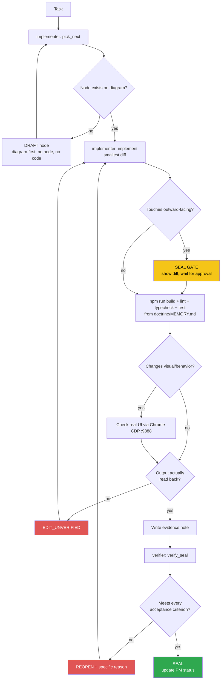

<!-- Diagram: dev-loop -->
<!-- Dev loop: plan - implement - verify - seal -->
DNA: 'smallest_diff / edit_x_read_back_proof_x_independent_verdict'
Auth: 65537 | Version: 1.0.0
Law: LAI-13 - monotonic ratchet (PENDING -> IN_PROGRESS -> SEALED, never demote)

> Every change to the repo's code enters here and leaves as SEALED or
> REOPENED — no state in between.

## PM status
> Older SEALED nodes (2026-08-16 through 2026-08-19, then a 2nd pass
> 2026-08-31 covering 5 more nodes dated 2026-08-25/2026-08-29) moved to
> `haven/diagrams/dev-loop-archive.md` to keep this file small — every
> worker session reads this file in full. Nothing deleted: the archive
> has each row's full original text verbatim. The compact rows below
> point to it; open the archive only when you need the full story
> behind an old node. `pick_next` only needs non-archived rows. Run
> `/hub-tokens` periodically — if this file flags >15KB again, repeat
> this archiving pass for nodes older than the current work session.

| Node | State | Notes |
|---|---|---|

Any regression must be a **new node** (LAI-13) — never edit an old node's
PM status directly to "undo" an existing SEAL.
| `font-self-host-cls` | SEALED | 2026-10-27 — archived, see `haven/diagrams/dev-loop-archive.md`. Evidence: `evidence/verifier/2026-10-27/font-self-host-cls-seal.md`. |
| `experience-skills-inline` | SEALED | 2026-10-27 — archived, see `haven/diagrams/dev-loop-archive.md`. Evidence: `evidence/verifier/2026-10-27/experience-skills-inline-seal.md`. |
| `experience-skills-text` | SEALED | 2026-10-27 — archived, see `haven/diagrams/dev-loop-archive.md`. Evidence: `evidence/verifier/2026-10-27/experience-skills-text-seal.md`. |
| `experience-skills-after-desc` | SEALED | 2026-10-27 — archived, see `haven/diagrams/dev-loop-archive.md`. Evidence: `evidence/verifier/2026-10-27/experience-skills-after-desc-seal.md`. |
| `resume-content-locale` | SEALED | 2026-10-27 — archived, see `haven/diagrams/dev-loop-archive.md`. Evidence: `evidence/verifier/2026-10-27/resume-content-locale-seal.md`. |
| `vi-glyph-fallback` | SEALED | 2026-10-27 — archived, see `haven/diagrams/dev-loop-archive.md`. Evidence: `evidence/verifier/2026-10-27/vi-glyph-fallback-seal.md`. |
| `pages-nojekyll` | SEALED | 2026-10-31 — archived, see `haven/diagrams/dev-loop-archive.md`. Evidence: `evidence/verifier/2026-10-31/pages-nojekyll-seal.md`. |
| `skills-typo-map-drop` | SEALED | 2026-10-31 — archived, see `haven/diagrams/dev-loop-archive.md`. Evidence: `evidence/verifier/2026-10-31/skills-typo-map-drop-seal.md`. |
| `pdf-two-pages` | SEALED | 2026-10-31 — archived, see `haven/diagrams/dev-loop-archive.md`. Evidence: `evidence/verifier/2026-10-31/pdf-two-pages-seal.md`. |
| `blog-content-sanitize` | SEALED | 2026-10-31 — archived, see `haven/diagrams/dev-loop-archive.md`. Evidence: `evidence/verifier/2026-10-31/blog-content-sanitize-seal.md`. |
| `script-csp-report-only` | SEALED | 2026-10-31 — archived, see `haven/diagrams/dev-loop-archive.md`. Evidence: `evidence/verifier/2026-10-31/script-csp-report-only-seal.md`. |
| `projects-readable-mobile` | SEALED | 2026-11-01 — archived, see `haven/diagrams/dev-loop-archive.md`. Evidence: `evidence/verifier/2026-11-01/projects-readable-mobile-seal.md`. |
| `seo-titles-og-image` | SEALED | 2026-11-01 — archived, see `haven/diagrams/dev-loop-archive.md`. Evidence: `evidence/verifier/2026-11-01/seo-titles-og-image-seal.md`. |
| `remove-unused-deps-helpers` | SEALED | 2026-11-01 — archived, see `haven/diagrams/dev-loop-archive.md`. Evidence: `evidence/verifier/2026-11-01/remove-unused-deps-helpers-seal.md`. |
| `upstream-no-retry-429` | SEALED | 2026-11-01 — archived, see `haven/diagrams/dev-loop-archive.md`. Evidence: `evidence/verifier/2026-11-01/upstream-no-retry-429-seal.md`. |
| `sanitize-html-require-esm` | SEALED | 2026-11-01 — archived, see `haven/diagrams/dev-loop-archive.md`. Evidence: `evidence/verifier/2026-11-01/sanitize-html-require-esm-seal.md`. |
| `resume-isr-allow-lang` | SEALED | 2026-11-01 — archived, see `haven/diagrams/dev-loop-archive.md`. Evidence: `evidence/verifier/2026-11-01/resume-isr-allow-lang-seal.md`. |
| `resume-isr-allow-lang-live` | PENDING | 2026-11-01 — #361 follow-up, split from `resume-isr-allow-lang` (its acceptance 4 can't be proven before a deploy). Acceptance: on the Vercel preview of `bug/361` (or live after release), `/api/resume?lang=en` returns an introduction starting `Frontend Developer with 4+ years` and `?lang=vi` the VI one, with different etags — both quoted verbatim. Blocked on: push `bug/361` (operator-approved `/ship`). |
| `hero-main-familiar-api` | SEALED | 2026-11-02 — archived, see `haven/diagrams/dev-loop-archive.md`. Evidence: `evidence/verifier/2026-11-02/hero-main-familiar-api-seal.md`. |
| `skills-file-tabs` | SEALED | 2026-11-02 — archived, see `haven/diagrams/dev-loop-archive.md`. Evidence: `evidence/verifier/2026-11-02/skills-file-tabs-seal.md`. |
| `experience-pug-piped` | SEALED | 2026-11-02 — archived, see `haven/diagrams/dev-loop-archive.md`. Evidence: `evidence/verifier/2026-11-02/experience-pug-piped-seal.md`. |
