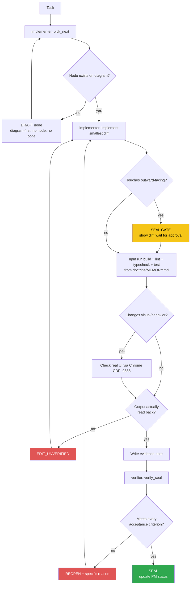

<!-- Diagram: dev-loop -->
<!-- Dev loop: plan - implement - verify - seal -->
DNA: 'smallest_diff / edit_x_read_back_proof_x_independent_verdict'
Auth: 65537 | Version: 1.0.0
Law: LAI-13 - monotonic ratchet (PENDING -> IN_PROGRESS -> SEALED, never demote)

> Every change to the repo's code enters here and leaves as SEALED or
> REOPENED — no state in between.

## PM status
> Older SEALED nodes (2026-08-16 through 2026-08-19, then a 2nd pass
> 2026-08-31 covering 5 more nodes dated 2026-08-25/2026-08-29) moved to
> `haven/diagrams/dev-loop-archive.md` to keep this file small — every
> worker session reads this file in full. Nothing deleted: the archive
> has each row's full original text verbatim. The compact rows below
> point to it; open the archive only when you need the full story
> behind an old node. `pick_next` only needs non-archived rows. Run
> `/hub-tokens` periodically — if this file flags >15KB again, repeat
> this archiving pass for nodes older than the current work session.

| Node | State | Notes |
|---|---|---|

Any regression must be a **new node** (LAI-13) — never edit an old node's
PM status directly to "undo" an existing SEAL.
| `resume-isr-allow-lang-live` | PENDING | 2026-11-01 — #361 follow-up, split from `resume-isr-allow-lang` (its acceptance 4 can't be proven before a deploy). Acceptance: on the Vercel preview of `bug/361` (or live after release), `/api/resume?lang=en` returns an introduction starting `Frontend Developer with 4+ years` and `?lang=vi` the VI one, with different etags — both quoted verbatim. Blocked on: push `bug/361` (operator-approved `/ship`). |
| `visit-ip-geo-check` | PENDING | 2026-11-05 — #398. Acceptance: (1) ≥2 real prod visits from different networks store the visitor's public IP + matching location, quoted from the backend's Visit records; (2) root cause located (relay vs backend), fixed here or linked backend issue; (3) `/api/visit` still returns 204. (2) done: relay correct (h3 1.15.11 `getRequestIP` takes the leftmost XFF entry = client on Vercel); backend `src/candidate_me/index.ts:258` stores `req.ip` with no `trust proxy` → proxy IP — tracked as datvt243/resume-nodejs-api#371. No diff in this repo. #371 fixed (backend PR #372, released v2.6.1 2026-11-05T11:59Z; reads leftmost XFF = what the relay sends). Blocked on: operator's 2 real visits from different networks + the stored Visit records. Evidence: `evidence/implementer/2026-11-05/visit-ip-geo-check-plan.md`. |
| `visit-local-count` | PENDING | 2026-11-05 — #389. Acceptance: (1) root cause stated, quoted from evidence; (2) local visits counted, or the non-count documented as intended (code comment / CLAUDE.md). App side ruled out: dev server against a mock backend → browser POST /api/visit 204 → relay POST `/api/me/<email>/visit` with `x-forwarded-for: ::1`. Backend v2.6.1 `handlerRecordVisit` + Visit model have no IP filter. Blocked on: seeing what the real backend stored for a local visit (Atlas MCP disabled for the org). Evidence: `evidence/implementer/2026-11-05/visit-local-count-plan.md`. |
| `pdf-filename-lang` | SEALED | 2026-11-06 — archived, see `haven/diagrams/dev-loop-archive.md`. Evidence: `evidence/verifier/2026-11-06/pdf-filename-lang-seal.md`. |
| `pdf-project-sort` | SEALED | 2026-11-05 — archived, see `haven/diagrams/dev-loop-archive.md`. Evidence: `evidence/verifier/2026-11-05/pdf-project-sort-seal.md`. |
| `resume-plain-mappers` | SEALED | 2026-11-05 — archived, see `haven/diagrams/dev-loop-archive.md`. Evidence: `evidence/verifier/2026-11-05/resume-plain-mappers-seal.md`. |
| `api-cache-revalidate` | SEALED | 2026-11-05 — archived, see `haven/diagrams/dev-loop-archive.md`. Evidence: `evidence/verifier/2026-11-05/api-cache-revalidate-seal.md`. |
| `hero-greeting-whoami` | SEALED | 2026-11-05 — archived, see `haven/diagrams/dev-loop-archive.md`. Evidence: `evidence/verifier/2026-11-05/hero-greeting-whoami-seal.md`. |
| `hero-about-me-intro` | SEALED | 2026-11-05 — archived, see `haven/diagrams/dev-loop-archive.md`. Evidence: `evidence/verifier/2026-11-05/hero-about-me-intro-seal.md`. |
| `hero-avatar-inline` | SEALED | 2026-11-05 — archived, see `haven/diagrams/dev-loop-archive.md`. Evidence: `evidence/verifier/2026-11-05/hero-avatar-inline-seal.md`. |
| `hero-intro-full-avatar-128` | SEALED | 2026-11-05 — archived, see `haven/diagrams/dev-loop-archive.md`. Evidence: `evidence/verifier/2026-11-05/hero-intro-full-avatar-128-seal.md`. |
| `hero-avatar-img-tag` | SEALED | 2026-11-05 — archived, see `haven/diagrams/dev-loop-archive.md`. Evidence: `evidence/verifier/2026-11-05/hero-avatar-img-tag-seal.md`. |
| `hero-avatar-img-tag-revert` | SEALED | 2026-11-05 — archived, see `haven/diagrams/dev-loop-archive.md`. Evidence: `evidence/verifier/2026-11-05/hero-avatar-img-tag-revert-seal.md`. |
| `ats-pdf-skills-heading` | SEALED | 2026-11-05 — archived, see `haven/diagrams/dev-loop-archive.md`. Evidence: `evidence/verifier/2026-11-05/ats-pdf-skills-heading-seal.md`. |
| `ats-pdf-address-label` | SEALED | 2026-11-05 — archived, see `haven/diagrams/dev-loop-archive.md`. Evidence: `evidence/verifier/2026-11-05/ats-pdf-address-label-seal.md`. |
| `resume-hr-view` | SEALED | 2026-11-05 — archived, see `haven/diagrams/dev-loop-archive.md`. Evidence: `evidence/verifier/2026-11-05/resume-hr-view-seal.md`. |
| `resume-hr-emphasis` | SEALED | 2026-11-05 — archived, see `haven/diagrams/dev-loop-archive.md`. Evidence: `evidence/verifier/2026-11-05/resume-hr-emphasis-seal.md`. |
| `resume-hr-skills-table` | SEALED | 2026-11-05 — archived, see `haven/diagrams/dev-loop-archive.md`. Evidence: `evidence/verifier/2026-11-05/resume-hr-skills-table-seal.md`. |
| `resume-hr-icons-exp` | SEALED | 2026-11-05 — archived, see `haven/diagrams/dev-loop-archive.md`. Evidence: `evidence/verifier/2026-11-05/resume-hr-icons-exp-seal.md`. |
| `hero-download-shortcut-D` | SEALED | 2026-11-05 — archived, see `haven/diagrams/dev-loop-archive.md`. Evidence: `evidence/verifier/2026-11-05/hero-download-shortcut-D-seal.md`. |
| `pdf-cv-filename` | SEALED | 2026-11-05 — archived, see `haven/diagrams/dev-loop-archive.md`. Evidence: `evidence/verifier/2026-11-05/pdf-cv-filename-seal.md`. |
| `skill-icons-390` | SEALED | 2026-11-06 — archived, see `haven/diagrams/dev-loop-archive.md`. Evidence: `evidence/verifier/2026-11-06/skill-icons-390-seal.md`. |
| `hr-exp-past-icon` | SEALED | 2026-11-06 — archived, see `haven/diagrams/dev-loop-archive.md`. Evidence: `evidence/verifier/2026-11-06/hr-exp-past-icon-seal.md`. |
